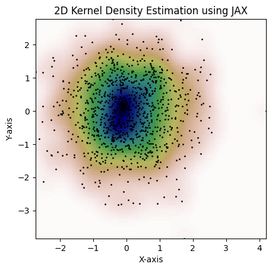
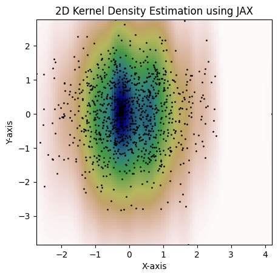
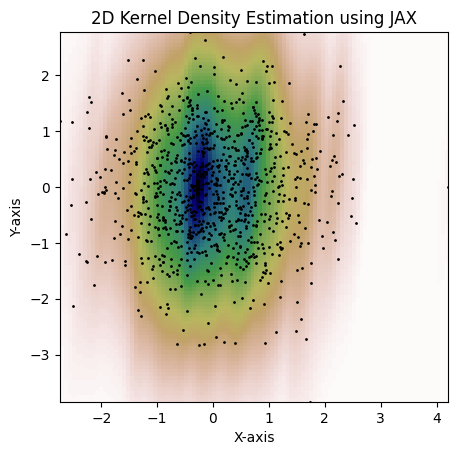
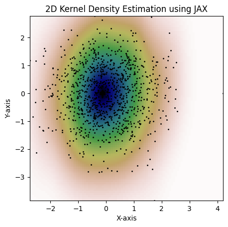
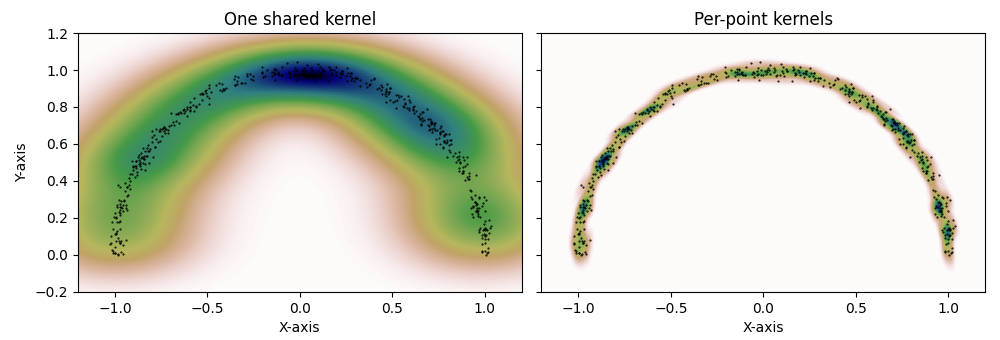

<h1 align='center'> <code>mvgkde</code> </h1>
<h3 align="center">MultiVariate Gaussian Kernel Density Estimator in JAX.</h3>

This is a micro-package, containing the single class `MultiVarGaussianKDE` (and
helper function `gaussian_kde`) to estimate the probability density function of
a multivariate dataset using a Gaussian kernel. This package modifies the
`jax.scipy.stats.gaussian_kde` class (which is based on the
`scipy.stats.gaussian_kde` class), but allows for full control over the
covariance matrix of the kernel, even per-dimension bandwidths. See the
Documentation below for more information.

## Installation

[![PyPI version][pypi-version]][pypi-link]
[![PyPI platforms][pypi-platforms]][pypi-link]

```bash
pip install mvgkde
```

## Documentation

[![Actions Status][actions-badge]][actions-link]

For these examples we will use the following imports:

```python
import jax.numpy as jnp
import jax.random as jr
import matplotlib.pyplot as plt
import numpy as np

from mvgkde import MultiVariateGaussianKDE, gaussian_kde  # This package
```

And we will generate a dataset to work with:

```python
key = jr.key(0)
dataset = jr.normal(key, (2, 1000))
```

Lastly we will define a plotting function:

```python
# Create a grid of points
(xmin, ymin) = dataset.min(axis=1)
(xmax, ymax) = dataset.max(axis=1)
X, Y = np.mgrid[xmin:xmax:100j, ymin:ymax:100j]
positions = np.vstack([X.ravel(), Y.ravel()])


def plot_kde(kde: MultiVariateGaussianKDE) -> plt.Figure:
    # Evaluate the KDE on the grid
    Z = np.reshape(kde(positions).T, X.shape)

    # Plot the results
    fig, ax = plt.subplots()
    ax.imshow(np.rot90(Z), cmap=plt.cm.gist_earth_r, extent=[xmin, xmax, ymin, ymax])
    ax.plot(dataset[0], dataset[1], "k.", markersize=2)
    ax.set(
        title="2D Kernel Density Estimation using JAX",
        xlabel="X-axis",
        xlim=[xmin, xmax],
        ylabel="Y-axis",
        ylim=[ymin, ymax],
    )

    return fig
```

Here's an example that can be done with `jax.scipy.stats.gaussian_kde`:

```python
kde = gaussian_kde(dataset, bw_method="scott")

fig = plot_kde(kde)
plt.show()
```



Here's an example with a per-dimension bandwidth. This is not possible with the
`jax.scipy.stats.gaussian_kde`:

```python
kde = gaussian_kde(dataset, bw_method=jnp.array([0.15, 1.3]))

fig = plot_kde(kde)
plt.show()
```



Lastly, here's an example with 2D bandwidth matrix:

```python
bw = jnp.array([[0.15, 3], [3, 1.3]])
kde = gaussian_kde(dataset, bw_method=bw)

fig = plot_kde(kde)
plt.show()
```



The previous examples are using the convenience function `gaussian_kde`. This
actually just calls the constructor method
`MultiVariateGaussianKDE.from_bandwidth`. This function allows for customixing
the bandwidth factor on the data-driven covariance matrix, but does not allow
for specifying the covariance matrix directly. To do that, you can call the
`MultiVariateGaussianKDE` constructor directly, or the `from_covariance`
constructor method. To illustrate the difference between modifying the bandwidth
and setting the full covariance matrix, consider the following example:

```python
kde = MultiVariateGaussianKDE.from_covariance(
    dataset,
    jnp.array([[0.15, 0.1], [0.1, 1.3]]),
)

fig = plot_kde(kde)
plt.show()
```



### Per-point kernels

Every example so far uses one kernel for all the data points. That works badly
for data along a thin curve, because one covariance can't be narrow across the
curve and long along it everywhere at once. Here is a thin half-circle arc:

```python
k1, k2 = jr.split(jr.key(1))
theta = jr.uniform(k1, (500,), minval=0, maxval=jnp.pi)
r = 1 + 0.02 * jr.normal(k2, (500,))
arc = jnp.stack([r * jnp.cos(theta), r * jnp.sin(theta)])

shared = gaussian_kde(arc)
local = MultiVariateGaussianKDE.from_local_covariance(arc)
```

`from_local_covariance` gives each data point its own kernel, so `covariance`
has shape `(N, d, d)`. Each kernel is Scott's factor for `k` points, squared,
times the weighted covariance of the point's neighbours. The default is
`k = round(sqrt(n))`, with `n` the number of points with positive weight.
Neighbour `j` gets weight `w_j exp(-d_j² / 2r²)`, where `r` is chosen so the
Gaussian factors of the other points sum to `k`. That makes `r` a smooth version
of the distance to the `k`-th nearest neighbour, so the density and its
gradients change smoothly when the data move. You can also pass your own
`(N, d, d)` covariance to `from_covariance`.

```python
X, Y = np.mgrid[-1.2:1.2:300j, -0.2:1.2:175j]
grid = np.vstack([X.ravel(), Y.ravel()])

fig, axs = plt.subplots(1, 2, figsize=(10, 3.4), sharey=True)
for ax, kde, title in [
    (axs[0], shared, "One shared kernel"),
    (axs[1], local, "Per-point kernels"),
]:
    Z = np.reshape(kde(grid), X.shape)
    ax.imshow(np.rot90(Z), cmap=plt.cm.gist_earth_r, extent=[-1.2, 1.2, -0.2, 1.2])
    ax.plot(arc[0], arc[1], "k.", markersize=1)
    ax.set(title=title, xlabel="X-axis")
axs[0].set_ylabel("Y-axis")
plt.show()
```



On the left, the shared kernel smears the arc across its inside. On the right,
each kernel lies along the arc, and the density stays as thin as the data.
`evaluate`, `logpdf`, `resample`, `marginal` and `integrate_gaussian` all work
with per-point kernels. `evaluate` and `logpdf` take a `batch_size`, so memory
grows as `batch_size * N * d`.

## Contributing

Contributors and AI assistants: this repository ships a queryable code graph —
see [CONTRIBUTING.md](.github/CONTRIBUTING.md#the-code-graph).

## Acknowledgments

This package modifies code from [JAX](https://github.com/google/jax), which is
licensed under the Apache License 2.0.

[actions-badge]: https://github.com/nstarman/mvgkde/workflows/CI/badge.svg
[actions-link]: https://github.com/nstarman/mvgkde/actions
[pypi-link]: https://pypi.org/project/mvgkde/
[pypi-platforms]: https://img.shields.io/pypi/pyversions/mvgkde
[pypi-version]: https://img.shields.io/pypi/v/mvgkde
